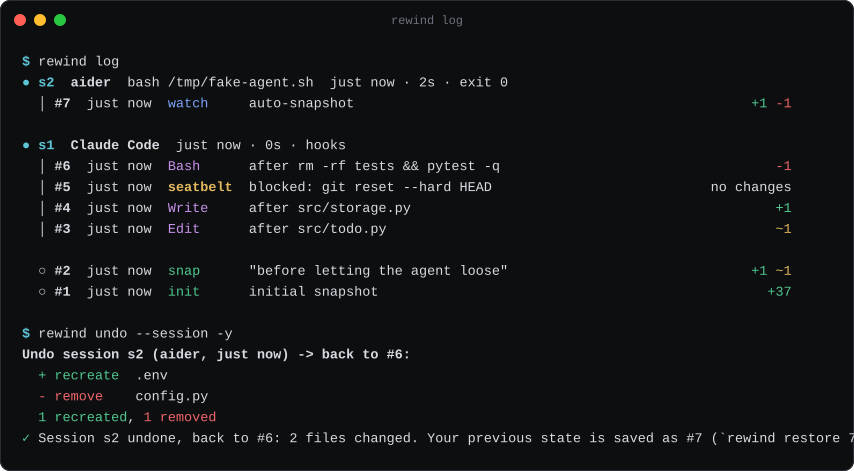
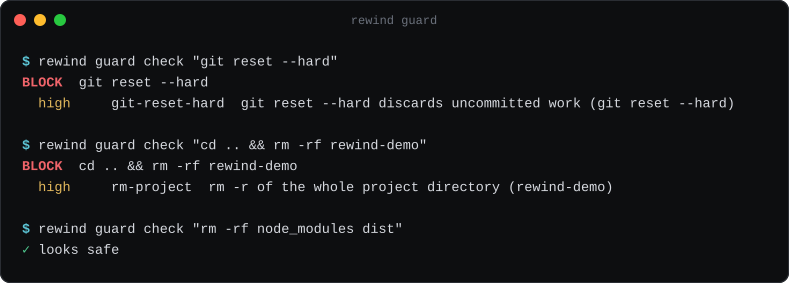
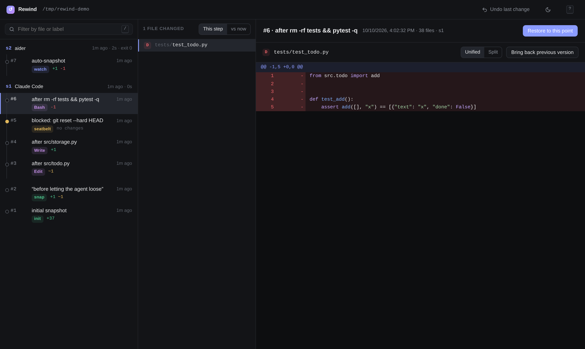

# Rewind

**An undo button for AI coding agents.** Rewind snapshots every file in your project (untracked files like `.env` and the `.git` directory included) before and while an agent works, so any change it makes can be rolled back with one command.

<p align="center"></p>

Works with Claude Code, Codex CLI, Gemini CLI, Cursor, Aider, OpenCode, or any script. Pure Python standard library: no runtime dependencies, nothing to configure.

## Quickstart

```sh
pipx install rewind-cli        # or: uv tool install rewind-cli
rewind init                    # in your project; offers to install agent hooks
rewind run -- claude           # or codex, aider, gemini, ./any-script.sh
```

When the agent wrecks something:

```sh
rewind undo --session          # put the whole session back
rewind undo                    # or just the last change
rewind back 10m                # or the project as it was 10 minutes ago
rewind recover .env            # or one deleted file
```

Every restore takes a safety snapshot first, so an undo can itself be undone (`rewind redo`).

Other ways to install: `uvx rewind-cli` runs it without installing, and there is a one-line installer that picks uv, pipx or pip:

```sh
curl -fsSL https://raw.githubusercontent.com/rewind-cli/rewind/main/install.sh | sh
```

(Rewind's own seatbelt flags `curl | sh`. [Read the script](install.sh) first; it is 50 lines.)

## Why not just git?

Git protects what you committed. Agents mostly destroy what you didn't:

| | git | Rewind |
|---|---|---|
| Uncommitted edits | lost on `git reset --hard` / `git checkout -- .` | snapshotted before the command runs |
| Untracked files (`.env`, local SQLite DBs, scratch notes) | never stored; `git clean -fdx` deletes them for good | stored like any other file |
| Ignored files | invisible to git | stored unless you list them in `.rewindignore` |
| The `.git` directory itself | a corrupted or deleted `.git` takes your history with it | `.git` is snapshotted too, and restored byte-for-byte |
| Granularity | when you remember to commit | before every agent edit and shell command (with hooks), or every few seconds (with `run`/`watch`) |
| Undo the undo | reflog, if you know where to look | every restore is snapshotted first |

Rewind is not a replacement for git or for backups. It is a local, short-term safety net for the hours an agent has write access to your files.

## How it works

```
  agent (Claude Code, Codex, ...)           your project
  ───────────────────────────────           ────────────
   PreToolUse hook ──► rewind hook exec ─┐   src/  .env  .git/  data/local.db
   (or: rewind run / rewind watch)       │        │
                                         ▼        ▼ scan: stat every file, hash only
                                  ┌──────────────────┐   those whose size/mtime/inode changed
                 seatbelt ◄────── │  rewind capture  │
           (block / snapshot /    └────────┬─────────┘
            warn on rm -rf, ...)           │
                                           ▼
   .rewind/ ── objects/ab/cdef…   file contents, sha256-addressed, zlib-compressed, stored once
            ├─ snapshots/0042.json  {time, session, tool, command, stats, manifest → object}
            ├─ sessions/s7.json     {agent, command, start snapshot, exit code, duration}
            └─ index.json           stat cache that makes no-op snapshots cheap
```

- A **snapshot** is a manifest (path → hash, mode, or symlink target) stored as an object itself. Unchanged files cost nothing; identical trees share one manifest; "nothing changed" is detected and skipped.
- A **session** groups the snapshots of one agent run: `rewind run` creates one per command, and hooks create one per agent conversation (`session_id`). `rewind undo --session` restores the session's starting snapshot.
- A **restore** computes the difference between your files and the target snapshot, records a safety snapshot of the current state, then writes, recreates and deletes files. File modes, symlinks, binary files, renames and file/directory swaps are handled. Files matched by `.rewindignore` are never touched.

The store lives in `.rewind/` (it adds its own `.gitignore`), or in `~/.rewind/projects/<hash>` with `rewind init --global`, which also keeps it out of the agent's reach.

## The seatbelt

<p align="center"></p>

When hooks are installed, every shell command an agent wants to run first goes through `rewind guard`. It parses the command (`shlex`), splits `;`, `&&`, `||` and pipes, follows `cd`, unwraps `sudo`, `env`, `timeout`, `xargs`, `bash -c` and `eval`, and checks each part against rules including:

- `rm -r` on `/`, system directories, `~`, paths outside the project, the project itself, `.git`, `.rewind`, or an unexpanded `$VAR`
- `git reset --hard`, `git clean -f`, `git checkout -- .` / `git restore .`, force-push to `main`/`master`, `git stash clear`, `git reflog expire --expire=now`
- `find -delete` / `-exec rm`, `dd of=`, `mkfs`, writes to block devices, `chmod -R 777`, `truncate`, `shred`
- `DROP DATABASE|TABLE|SCHEMA`, `TRUNCATE TABLE`, `DELETE FROM` without `WHERE`, `dropdb`, `rails db:drop`, `prisma migrate reset`
- `curl … | sh` and `sh -c "$(curl …)"`, fork bombs, deleting or overwriting an existing `.env`

`rewind guard rules` lists them all. What happens on a match is set by `guard.mode`:

| mode | effect |
|---|---|
| `block` (default) | the hook exits with code 2 and tells the agent why; nothing runs |
| `snapshot` | a snapshot labelled `seatbelt` is taken and the command runs |
| `warn` | a warning is printed, a normal snapshot is taken, the command runs |
| `off` | no checks |

Catastrophic commands (`rm -rf /`, `rm -rf ~`, `mkfs`, `dd` to a disk, fork bombs) are blocked in every mode except `off`. Allow a specific command with `rewind guard allow "git reset --hard origin/*"` or disable a rule with `rewind config set guard.disable '["git-clean"]'`. Try it without an agent: `rewind guard check "<command>"`.

This is a heuristic, not a sandbox. It cannot see inside a script the agent writes and then runs, which is why Rewind also snapshots before every command regardless.

## Agent integration

| Agent | How | What Rewind does | Status |
|---|---|---|---|
| **Claude Code** | `rewind hook install claude` → `.claude/settings.json` (`--local` for `settings.local.json`) | `PreToolUse` and `PostToolUse` on `Write\|Edit\|MultiEdit\|NotebookEdit\|Bash`: snapshot before and after; seatbelt on `Bash` and on `Write` to `.env` (exit 2 + reason on stderr) | Hook JSON follows the documented format; tested by feeding the documented stdin payloads to `rewind hook exec`. Not yet tested against a live Claude Code session in CI. |
| **Codex CLI** | `rewind hook install codex` → `.codex/hooks.json` | `PreToolUse`/`PostToolUse` on `Bash\|apply_patch`; seatbelt on `Bash` | Per OpenAI's hooks docs. Codex asks you to review and trust new hooks (`/hooks`). Tested with simulated payloads only. |
| **Gemini CLI** | `rewind hook install gemini` → `.gemini/settings.json` | `BeforeTool`/`AfterTool` on `run_shell_command\|write_file\|replace`; seatbelt on shell commands | Per the Gemini CLI hooks reference. Tested with simulated payloads only. |
| **Cursor** | `rewind hook install cursor` → `.cursor/hooks.json` | `beforeShellExecution` (seatbelt + snapshot, JSON `permission` response), `afterShellExecution`, `afterFileEdit` | Per Cursor's hooks docs. Cursor has no hook *before* a file edit, so run `rewind watch --daemon` alongside for pre-edit snapshots. Tested with simulated payloads only. |
| **Aider, OpenCode, Goose, Amp, anything else** | `rewind run -- <command>` | Checkpoint before, polling watcher during, checkpoint after, all recorded as one session | Works with any process; no seatbelt (there is no hook to intercept commands). |

`rewind run -- claude` and hooks combine: hook snapshots join the `run` session via the `REWIND_SESSION` environment variable. Hooks fail open: if Rewind itself errors, the agent is never blocked (errors go to `.rewind/hook-errors.log`).

## Commands

| | |
|---|---|
| `rewind init [--global] [--hooks claude,codex]` | set up the project and take the first snapshot |
| `rewind run [--name N] -- <cmd>` | run a command as a recorded session |
| `rewind watch [--daemon]` / `watch status` / `watch stop` | auto-snapshot as files change (polling, debounced) |
| `rewind snap [-m msg]` | checkpoint now (no-op if nothing changed) |
| `rewind undo [paths]` / `rewind redo` | step back / forward through snapshots |
| `rewind undo --session [sN]` | restore the state before an agent session |
| `rewind restore <id> [paths…] [--keep-new]` | restore everything, or some paths/globs, from a snapshot |
| `rewind back 10m` / `back "2 hours"` / `back 14:30` | restore the latest snapshot at or before a time |
| `rewind recover <path\|glob>…` | bring back deleted files from the latest snapshot that had them, touching nothing else |
| `rewind log [--files] [--session sN]` | timeline grouped by session |
| `rewind show <id> [-p]` / `rewind diff [id] [id] [path]` | inspect changes, with colored diffs |
| `rewind ui` | local web UI |
| `rewind status` / `rewind doctor [--full]` | store info, pending changes, integrity check |
| `rewind gc [--dry-run]` | apply the retention policy |
| `rewind guard check\|allow\|rules` | the seatbelt |
| `rewind hook install\|uninstall\|status <agent>` | agent hooks |
| `rewind config [get\|set\|unset] [key] [value]` | settings |

Snapshot references are numbers (`12` or `#12`), `HEAD`, or `HEAD~2`. Every command that restores files or deletes snapshots shows a preview and asks first; `-y` skips the prompt and `-n/--dry-run` changes nothing. In a non-interactive shell Rewind refuses to change files without `-y`. Output is colored on a TTY and respects `NO_COLOR`.

## Web UI

`rewind ui` serves a single self-contained page on `127.0.0.1` with a random token in the URL, and opens your browser. No CDN, no build step.

<p align="center"></p>

Timeline on the left, changed files in the middle, unified or split diff on the right. "This step" shows what a snapshot changed; "vs now" shows what restoring it would change. Restore one file or the whole project, with a confirmation dialog. Keys: `j`/`k` snapshots, `J`/`K` files, `/` filter, `r` restore file, `u` undo, `s` split view, `t` theme, `?` help. Light theme: [screenshot](docs/ui-light.png).

The API only answers requests carrying the token in a header and a `Host` of `127.0.0.1`/`localhost`, which blocks cross-site requests and DNS rebinding.

## Configuration

`rewind config` prints every setting with its current value. Stored in `.rewind/config.json`.

| key | default | |
|---|---|---|
| `max_file_size_mb` | `50` | larger files are skipped (`rewind doctor` lists them) |
| `include_git` | `true` | snapshot the `.git` directory |
| `watch.interval` | `1.0` | seconds between polls |
| `watch.debounce` | `2.0` | seconds of quiet before a snapshot |
| `watch.max_wait` | `30.0` | snapshot anyway after this much continuous change |
| `guard.mode` | `"block"` | `block`, `snapshot`, `warn`, `off` |
| `guard.allow` | `[]` | glob patterns matched against the whole command |
| `guard.disable` | `[]` | rule ids to turn off |
| `gc.keep_all_hours` | `24` | keep every snapshot this young |
| `gc.hourly_days` | `7` | then one per hour |
| `gc.daily_days` | `30` | then one per day; older snapshots are deleted |

**`.rewindignore`** uses gitignore syntax and is created by `rewind init` with defaults for dependency folders, caches and build output (`node_modules/`, `.venv/`, `__pycache__/`, `dist/`, `build/`, `target/`, `.next/`, …). Unlike git, untracked files such as `.env` are snapshotted by default; that is the point. Ignored files are never snapshotted and never touched by a restore.

## Performance

Measured on a 2-vCPU aarch64 Linux VM with Python 3.12, on a generated project of 10,000 Python files (14 MB):

| | time |
|---|---|
| `rewind init` (hashes and stores everything) | 0.68 s |
| `rewind snap` when nothing changed | 0.13 s |
| `rewind snap` after editing one file | 0.18 s |
| `rewind --version` (startup) | 0.03 s |

A hook call costs roughly one no-op snapshot. These are single runs on one machine, not a benchmark suite; your numbers will differ. Scan time grows with file count, not file size, because unchanged files are only `stat`ed.

## FAQ

**Where are my secrets stored?** Snapshots of `.env` and similar files live in `.rewind/objects`, compressed but not encrypted, with the same permissions as your project. `.rewind/` contains a `.gitignore` of `*`, so git never picks it up. Use `rewind init --global` to keep the store in `~/.rewind` instead.

**How much disk does it use?** Each distinct file version is stored once, zlib-compressed. Editing one line of a file stores one new compressed copy of that file. `rewind status` shows the store size and `rewind gc` applies the retention policy.

**Can the agent delete the snapshots?** It could try. The seatbelt blocks `rm -r` on `.rewind` (`rm-rewind-store`), and `--global` puts the store outside the project. A determined process running as you can still delete anything you can.

**Does it slow the agent down?** Each hook call scans with `stat` only and hashes changed files; see Performance. Hook entries are installed with a 30 s timeout where the agent supports one, and they fail open.

**What about huge files and model weights?** Files over `max_file_size_mb` are skipped and listed by `rewind doctor`; raise the limit or add them to `.rewindignore`.

**What is not restored?** Empty directories, file ownership, extended attributes and timestamps (restored files get a new mtime). Skipped large files and ignored paths are left as they are.

**Windows?** Best effort: the code uses `pathlib` and avoids POSIX-only calls, but it is not tested on Windows yet, and symlinks there need extra privileges.

**Is the seatbelt a security boundary?** No. It catches common destructive commands from cooperative agents. Use containers or a sandbox if you need isolation.

## Roadmap

- Native file-system events (FSEvents/inotify) as an optional fast path for `watch`
- Tree-structured manifests so very large repos store less per snapshot
- `rewind export <id>` to a tarball, and a read-only `rewind mount`
- Verified end-to-end tests against live Claude Code, Codex and Gemini CLI sessions
- Windows CI

## Contributing

Bug reports with a reproduction are the most useful contribution. See [CONTRIBUTING.md](CONTRIBUTING.md) for setup (`pip install -e . pytest && pytest`), and [SECURITY.md](SECURITY.md) for reporting vulnerabilities. Seatbelt false positives and false negatives are especially welcome: add a case to `tests/test_guard.py`.

## License

[MIT](LICENSE)
