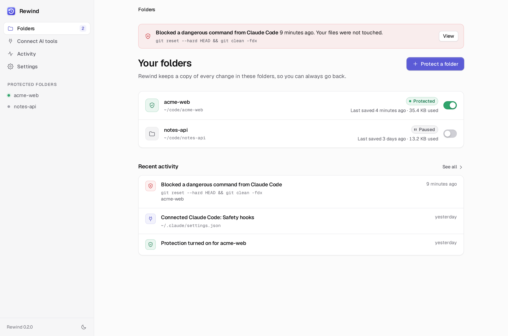
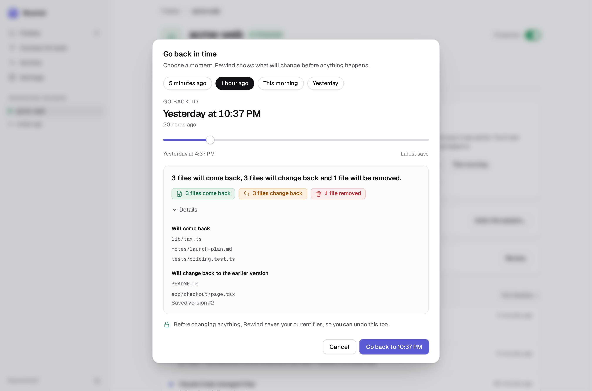
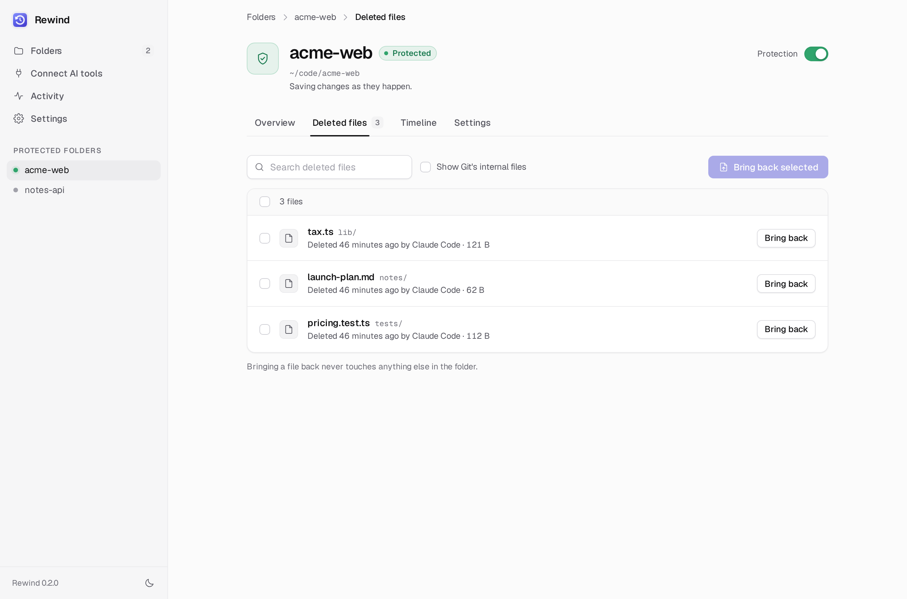
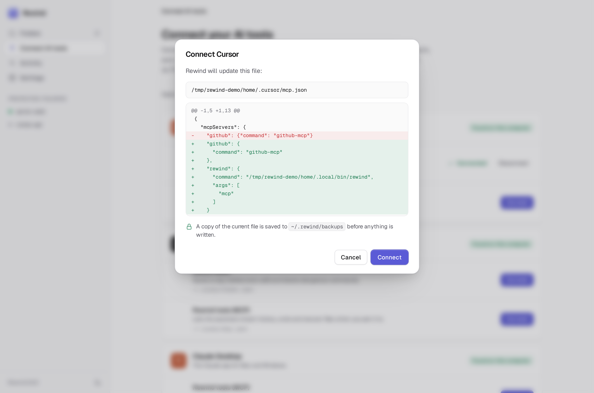
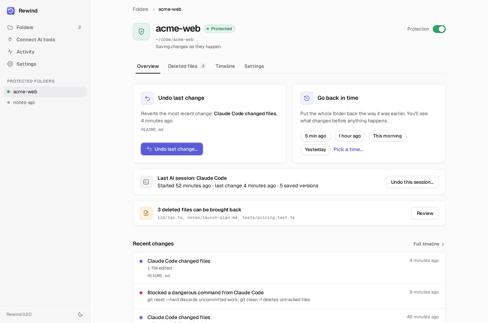
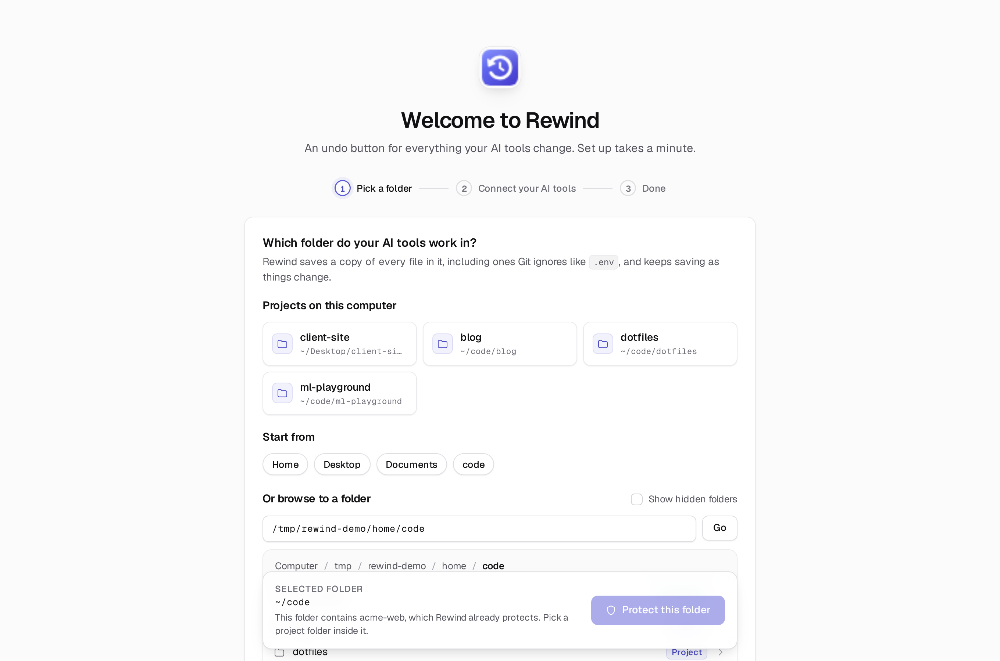
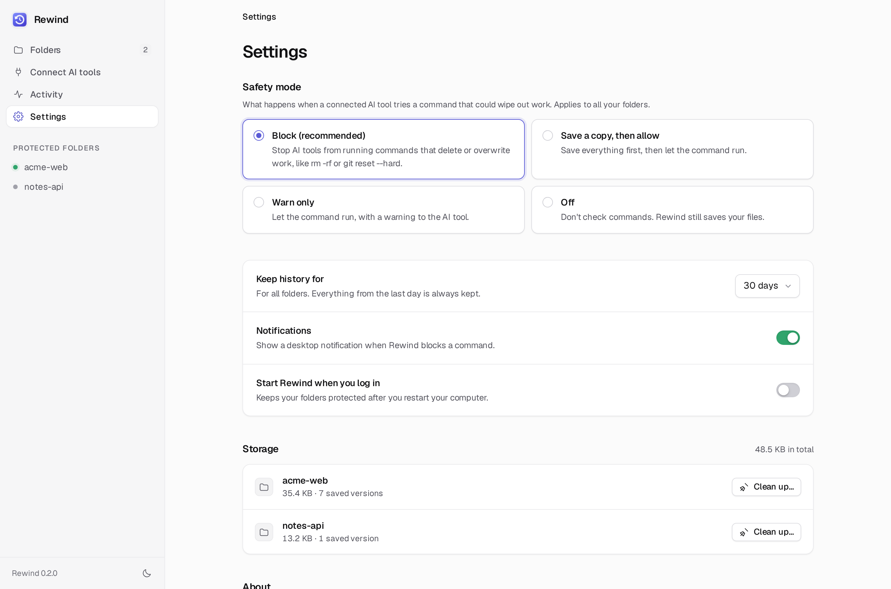

# Rewind

<p align="center"><a href="docs/demo.mp4"></a></p>

**An undo button for AI coding agents.** Rewind snapshots every file in your project (untracked files like `.env` and the `.git` directory included) before and while an agent works, so any change it makes can be rolled back with one command.

<p align="center"></p>

Works with Claude Code, Codex CLI, Gemini CLI, Cursor, Claude Desktop, Windsurf, VS Code, Aider, OpenCode, or any script. Pure Python standard library: no runtime dependencies, nothing to configure. Use it from the terminal, or from the Rewind app if you'd rather never open one.

## For everyone: the Rewind app

<p align="center"></p>

The app is a local control center that runs in your browser. It does everything the CLI does, in plain language:

- **Protect a folder.** Pick it from the projects Rewind finds, or browse to it. Rewind saves a copy of every file (including `.env` and other files Git ignores) and keeps saving as things change. One switch pauses or resumes it.
- **Undo last change**, with a preview first: "1 file will come back, 2 files will change back and 1 file will be removed." If you change your mind, Redo puts it back.
- **Go back in time** to 5 minutes ago, 1 hour ago, this morning, yesterday, or any saved moment on a slider. You always see what will change before you confirm, and your current files are saved first so going back can be undone too.
- **Recover deleted files** one at a time or in bulk, without touching anything else.
- **Connect your AI tools** in one click. Rewind detects Claude Code, Codex CLI, Gemini CLI, Cursor, Claude Desktop, Windsurf and VS Code, shows you the exact settings file it will change and the diff, and backs that file up to `~/.rewind/backups/` before writing.
- **Settings in plain words**: what happens when an AI tool tries something dangerous (block, save a copy first, warn, or off), how long to keep history, how much space it uses and a Clean up button, notifications, and start at login.
- **Activity**: every blocked command, restore and connection, across all folders. When the seatbelt blocks something you also get a desktop notification (best effort: `notify-send` on Linux, `osascript` on macOS).

| | | |
|---|---|---|
|  |  |  |
| Go back in time | Recover deleted files | Connect AI tools (with the diff) |
|  |  |  |
| A folder | First run | Settings |

More: [onboarding step 2](docs/app-onboarding-tools.png), [connect screen](docs/app-connect.png), [activity](docs/app-activity.png), [technical timeline](docs/app-timeline.png), [dark mode](docs/app-home-dark.png) (every screen also has a `-dark` or `-light` variant in `docs/`), and a [short screen recording of the motion](docs/app-motion.mp4). These screenshots come from `scripts/screenshots.py`, which builds a demo home folder with [`scripts/make-app-demo.py`](scripts/make-app-demo.py) using Rewind's real hook, restore and seatbelt code; only the snapshot timestamps are spread over a day afterwards so the time slider has something to show.

### Install it without a terminal (almost)

You need one command, once:

```sh
# macOS / Linux: installs Rewind with uv or pipx, then adds Rewind to Applications / your app menu
curl -fsSL https://raw.githubusercontent.com/rushi053/rewind/main/install.sh | sh
```

```powershell
# Windows (PowerShell): installs Rewind, then adds it to the Start menu and Desktop
irm https://raw.githubusercontent.com/rushi053/rewind/main/install.ps1 | iex
```

(Rewind's own seatbelt flags `curl | sh`. Read [install.sh](install.sh) and [install.ps1](install.ps1) first; they are short.) After that, open **Rewind** like any other app. The first run walks you through three steps: pick a folder, connect your AI tools, done.

Already have it installed? `rewind app` opens it, and `rewind app install-launcher` adds the launcher:

| | launcher | start at login (`rewind app --autostart on`, or the switch in Settings) |
|---|---|---|
| macOS | `~/Applications/Rewind.app`, a minimal bundle whose executable runs `rewind app`. Also buildable with [`scripts/build-macos-app.sh`](scripts/build-macos-app.sh). | LaunchAgent `~/Library/LaunchAgents/dev.rewind.app.plist` |
| Linux | `~/.local/share/applications/rewind.desktop` plus icon | systemd user unit `rewind-app.service`, or `~/.config/autostart/rewind.desktop` without systemd |
| Windows | `%LOCALAPPDATA%\Rewind\Rewind.vbs` (no console window) and `Rewind.bat`, with Desktop and Start menu shortcuts | `Rewind.vbs` in your Startup folder |

Generic copies that rely on `rewind` being on your PATH are in [`scripts/launchers/`](scripts/launchers/).

**How it runs.** `rewind app` starts one background server per user on `127.0.0.1` (port 47823 if free), opens your browser, and exits; running it again reuses the server that's already up. Protecting a folder starts a background watcher for it (the same one as `rewind watch --daemon`), and the app restarts watchers that die. Closing the browser tab changes nothing; `rewind app stop` stops the server, and watchers keep protecting your folders. With start at login on, protection resumes after a reboot. The app keeps its list of folders in `~/.rewind/registry.json`; each folder's history stays where it always was (`.rewind/` inside it, or `~/.rewind/projects/`).

**Security.** The API only answers requests that carry the token from `~/.rewind/app-token` (readable only by you) in a header, with a `Host` of `127.0.0.1`/`localhost`, and rejects cross-origin POSTs. The folder browser lists folder names only, never file contents. The page has a strict Content-Security-Policy and loads nothing from the internet; its typeface (Geist and Geist Mono, SIL Open Font License) is bundled with Rewind.

**What was tested.** Everything above was built and tested on Linux: the app's API and every screen are covered by the test suite and a headless-Chromium click-through ([`scripts/ui-smoke.py`](scripts/ui-smoke.py)) that protects a folder, undoes, goes back in time, recovers a file, connects a tool and walks the onboarding, checking the files on disk after each step. The macOS bundle, LaunchAgent, Windows `.vbs`/`.bat`/shortcuts and Startup entry are generated by tested code (their contents are checked in tests), but they have **not been run on macOS or Windows yet**. Reports welcome.

## Quickstart (terminal)

```sh
pipx install rewind-cli        # or: uv tool install rewind-cli
rewind init                    # in your project; offers to install agent hooks
rewind run -- claude           # or codex, aider, gemini, ./any-script.sh
```

When the agent wrecks something:

```sh
rewind undo --session          # put the whole session back
rewind undo                    # or just the last change
rewind back 10m                # or the project as it was 10 minutes ago
rewind recover .env            # or one deleted file
```

Every restore takes a safety snapshot first, so an undo can itself be undone (`rewind redo`).

Other ways to install: `uvx rewind-cli` runs it without installing, and there is a one-line installer that picks uv, pipx or pip:

```sh
curl -fsSL https://raw.githubusercontent.com/rushi053/rewind/main/install.sh | sh
```

(Rewind's own seatbelt flags `curl | sh`. [Read the script](install.sh) first; it is 75 lines. Set `REWIND_NO_LAUNCHER=1` to skip the app launcher.)

## Why not just git?

Git protects what you committed. Agents mostly destroy what you didn't:

| | git | Rewind |
|---|---|---|
| Uncommitted edits | lost on `git reset --hard` / `git checkout -- .` | snapshotted before the command runs |
| Untracked files (`.env`, local SQLite DBs, scratch notes) | never stored; `git clean -fdx` deletes them for good | stored like any other file |
| Ignored files | invisible to git | stored unless you list them in `.rewindignore` |
| The `.git` directory itself | a corrupted or deleted `.git` takes your history with it | `.git` is snapshotted too, and restored byte-for-byte |
| Granularity | when you remember to commit | before every agent edit and shell command (with hooks), or every few seconds (with `run`/`watch`) |
| Undo the undo | reflog, if you know where to look | every restore is snapshotted first |

Rewind is not a replacement for git or for backups. It is a local, short-term safety net for the hours an agent has write access to your files.

## How it works

```
  agent (Claude Code, Codex, ...)           your project
  ───────────────────────────────           ────────────
   PreToolUse hook ──► rewind hook exec ─┐   src/  .env  .git/  data/local.db
   (or: rewind run / rewind watch)       │        │
                                         ▼        ▼ scan: stat every file, hash only
                                  ┌──────────────────┐   those whose size/mtime/inode changed
                 seatbelt ◄────── │  rewind capture  │
           (block / snapshot /    └────────┬─────────┘
            warn on rm -rf, ...)           │
                                           ▼
   .rewind/ ── objects/ab/cdef…   file contents, sha256-addressed, zlib-compressed, stored once
            ├─ snapshots/0042.json  {time, session, tool, command, stats, manifest → object}
            ├─ sessions/s7.json     {agent, command, start snapshot, exit code, duration}
            └─ index.json           stat cache that makes no-op snapshots cheap
```

- A **snapshot** is a manifest (path → hash, mode, or symlink target) stored as an object itself. Unchanged files cost nothing; identical trees share one manifest; "nothing changed" is detected and skipped.
- A **session** groups the snapshots of one agent run: `rewind run` creates one per command, and hooks create one per agent conversation (`session_id`). `rewind undo --session` restores the session's starting snapshot.
- A **restore** computes the difference between your files and the target snapshot, records a safety snapshot of the current state, then writes, recreates and deletes files. File modes, symlinks, binary files, renames and file/directory swaps are handled. Files matched by `.rewindignore` are never touched.

The store lives in `.rewind/` (it adds its own `.gitignore`), or in `~/.rewind/projects/<hash>` with `rewind init --global`, which also keeps it out of the agent's reach.

## The seatbelt

<p align="center"></p>

When hooks are installed, every shell command an agent wants to run first goes through `rewind guard`. It parses the command (`shlex`), splits `;`, `&&`, `||` and pipes, follows `cd`, unwraps `sudo`, `env`, `timeout`, `xargs`, `bash -c` and `eval`, and checks each part against rules including:

- `rm -r` on `/`, system directories, `~`, paths outside the project, the project itself, `.git`, `.rewind`, or an unexpanded `$VAR`
- `git reset --hard`, `git clean -f`, `git checkout -- .` / `git restore .`, force-push to `main`/`master`, `git stash clear`, `git reflog expire --expire=now`
- `find -delete` / `-exec rm`, `dd of=`, `mkfs`, writes to block devices, `chmod -R 777`, `truncate`, `shred`
- `DROP DATABASE|TABLE|SCHEMA`, `TRUNCATE TABLE`, `DELETE FROM` without `WHERE`, `dropdb`, `rails db:drop`, `prisma migrate reset`
- `curl … | sh` and `sh -c "$(curl …)"`, fork bombs, deleting or overwriting an existing `.env`

`rewind guard rules` lists them all. What happens on a match is set by `guard.mode`:

| mode | effect |
|---|---|
| `block` (default) | the hook exits with code 2 and tells the agent why; nothing runs |
| `snapshot` | a snapshot labelled `seatbelt` is taken and the command runs |
| `warn` | a warning is printed, a normal snapshot is taken, the command runs |
| `off` | no checks |

Catastrophic commands (`rm -rf /`, `rm -rf ~`, `mkfs`, `dd` to a disk, fork bombs) are blocked in every mode except `off`. Allow a specific command with `rewind guard allow "git reset --hard origin/*"` or disable a rule with `rewind config set guard.disable '["git-clean"]'`. Try it without an agent: `rewind guard check "<command>"`.

This is a heuristic, not a sandbox. It cannot see inside a script the agent writes and then runs, which is why Rewind also snapshots before every command regardless.

## Agent integration

There are three ways in, and they combine:

1. **Hooks** (Claude Code, Codex CLI, Gemini CLI, Cursor): the agent calls Rewind before and after every edit and shell command, so there is a snapshot before each change and the seatbelt can block dangerous commands. Per project (`rewind hook install claude`) or for every project at once (`rewind hook install claude --global`, which writes your user-level config; in folders Rewind doesn't protect the hook does nothing).
2. **MCP** (Claude Desktop, Cursor, Windsurf, VS Code, Claude Code): the assistant gets Rewind tools it can call when you ask ("undo that", "what changed in the last hour?", "bring back my .env"). See [MCP server](#mcp-server).
3. **`rewind run -- <command>`** (Aider, OpenCode, Goose, Amp, anything): checkpoint before, watcher during, checkpoint after, recorded as one session.

The app's **Connect AI tools** screen does 1 and 2 with one click each, showing the file and diff first.

| Tool | How | What Rewind does | Status |
|---|---|---|---|
| **Claude Code** | `rewind hook install claude [--global]` → `.claude/settings.json` (`--local`: `settings.local.json`; `--global`: `~/.claude/settings.json`) | `PreToolUse`/`PostToolUse` on `Write\|Edit\|MultiEdit\|NotebookEdit\|Bash`: snapshot before and after; seatbelt on `Bash` and on `Write` to `.env` (exit 2 + reason on stderr). Also installs the slash commands `/rewind-undo`, `/rewind-log`, `/rewind-checkpoint` in `.claude/commands/` | Hook JSON and command files follow the documented formats; hooks tested by feeding documented stdin payloads to `rewind hook exec`. **Not yet tested in a live Claude Code session**, including the slash commands. |
| **Codex CLI** | `rewind hook install codex [--global]` → `.codex/hooks.json` or `~/.codex/hooks.json` | `PreToolUse`/`PostToolUse` on `Bash\|apply_patch`; seatbelt on `Bash` | Per OpenAI's hooks docs. Codex asks you to review and trust new hooks (`/hooks`). Simulated payloads only. |
| **Gemini CLI** | `rewind hook install gemini [--global]` → `.gemini/settings.json` or `~/.gemini/settings.json` | `BeforeTool`/`AfterTool` on `run_shell_command\|write_file\|replace`; seatbelt on shell commands | Per the Gemini CLI hooks reference. Simulated payloads only. |
| **Cursor** | `rewind hook install cursor [--global]` → `.cursor/hooks.json` or `~/.cursor/hooks.json`; MCP: `rewind mcp install cursor [--global]` | `beforeShellExecution` (seatbelt + snapshot, JSON `permission` response), `afterShellExecution`, `afterFileEdit`; MCP tools | Per Cursor's hooks and MCP docs. Cursor has no hook *before* a file edit, so protect the folder in the app (or run `rewind watch --daemon`) for pre-edit snapshots. Simulated payloads only; MCP config written to the documented format, not tried in Cursor. |
| **Claude Desktop** | `rewind mcp install claude-desktop` → `claude_desktop_config.json` | MCP tools | Config path and format per the MCP quickstart. Not tried in Claude Desktop (no Linux build to test on). |
| **Windsurf** | `rewind mcp install windsurf` → `~/.codeium/windsurf/mcp_config.json` | MCP tools | Documented format; not tried in Windsurf. |
| **VS Code** (agent mode) | `rewind mcp install vscode [--global]` → `.vscode/mcp.json` or the user `mcp.json` | MCP tools | Documented `servers` format; not tried in VS Code. |
| **Aider, OpenCode, Goose, Amp, anything else** | `rewind run -- <command>` | Checkpoint before, polling watcher during, checkpoint after, all recorded as one session | Works with any process (tested). No seatbelt: there is no hook to intercept commands. |

"Not tried" means the files Rewind writes match each tool's published documentation and are covered by tests, but nobody has yet confirmed the tool picks them up. The MCP server itself is tested over real stdio with JSON-RPC messages shaped like a client's.

`rewind run -- claude` and hooks combine: hook snapshots join the `run` session via the `REWIND_SESSION` environment variable. Hooks fail open: if Rewind itself errors, the agent is never blocked (errors go to `.rewind/hook-errors.log`).

## MCP server

`rewind mcp` is a [Model Context Protocol](https://modelcontextprotocol.io) server over stdio, written with the standard library (JSON-RPC 2.0, newline-delimited). It speaks protocol version `2025-06-18` and negotiates down to `2025-03-26` or `2024-11-05` if the client asks for those. Tools:

| tool | what it does |
|---|---|
| `checkpoint(message)` | save a version of every file now |
| `list_history(limit)` | recent saved versions, newest first, with who changed what |
| `show_changes(id, diff?, path?)` | files a version changed; `diff: true` adds a unified diff |
| `undo_last()` | put back the previous version that differs from the current files |
| `restore(id, paths?)` | restore the whole project or some paths to a version |
| `recover_deleted(pattern)` | bring back deleted files matching a path or glob, touching nothing else |
| `check_command(command)` | ask the seatbelt whether a shell command is destructive; runs nothing |

**`undo_last`, `restore` and `recover_deleted` only preview** (what would come back, change, or be removed) unless called with `confirm: true`, and `dry_run: true` always wins. The server's instructions ask the model to show you the preview and get your agreement first. Every applied change saves the current files first, so it can be undone.

Which project? Clients started inside a project (Claude Code, VS Code, Cursor's project config) pass it with the working directory or `--folder ${workspaceFolder}`. Apps like Claude Desktop start servers outside any project; there every tool takes an optional `folder` argument, and if the app protects exactly one folder that one is used.

Set it up with `rewind mcp install <client>` (it backs up the config file first and prints the diff; `--dry-run` only prints), or paste the JSON yourself. `rewind mcp config <client>` prints the snippet with the full path of your `rewind` (GUI apps don't see your shell's PATH, so use the full path, e.g. `/Users/you/.local/bin/rewind`):

**Claude Desktop** (`~/Library/Application Support/Claude/claude_desktop_config.json` on macOS, `%APPDATA%\Claude\claude_desktop_config.json` on Windows), **Cursor** (`~/.cursor/mcp.json`) and **Windsurf** (`~/.codeium/windsurf/mcp_config.json`):

```json
{
  "mcpServers": {
    "rewind": { "command": "/Users/you/.local/bin/rewind", "args": ["mcp"] }
  }
}
```

**Cursor, per project** (`.cursor/mcp.json`):

```json
{
  "mcpServers": {
    "rewind": { "command": "/Users/you/.local/bin/rewind", "args": ["mcp", "--folder", "${workspaceFolder}"] }
  }
}
```

**VS Code** (`.vscode/mcp.json`; note the `servers` key and `type`):

```json
{
  "servers": {
    "rewind": { "type": "stdio", "command": "/Users/you/.local/bin/rewind", "args": ["mcp", "--folder", "${workspaceFolder}"] }
  }
}
```

**Claude Code**: `rewind mcp install claude-code` writes `.mcp.json` in the project (same shape as Claude Desktop's), and `rewind mcp install claude-code --global` runs `claude mcp add --scope user rewind -- <path to rewind> mcp` for you. **Codex CLI**: `codex mcp add rewind -- rewind mcp` (Rewind doesn't edit Codex's TOML config itself).

## Commands

| | |
|---|---|
| `rewind app` / `app status\|stop` / `app --autostart on\|off` / `app install-launcher` | the Rewind app (see above) |
| `rewind init [--global] [--hooks claude,codex]` | set up the project and take the first snapshot |
| `rewind run [--name N] -- <cmd>` | run a command as a recorded session |
| `rewind watch [--daemon]` / `watch status` / `watch stop` | auto-snapshot as files change (polling, debounced) |
| `rewind snap [-m msg]` | checkpoint now (no-op if nothing changed) |
| `rewind undo [paths]` / `rewind redo` | step back / forward through snapshots |
| `rewind undo --session [sN]` | restore the state before an agent session |
| `rewind restore <id> [paths…] [--keep-new]` | restore everything, or some paths/globs, from a snapshot |
| `rewind back 10m` / `back "2 hours"` / `back 14:30` | restore the latest snapshot at or before a time |
| `rewind recover <path\|glob>…` | bring back deleted files from the latest snapshot that had them, touching nothing else |
| `rewind log [--files] [--session sN]` | timeline grouped by session |
| `rewind show <id> [-p]` / `rewind diff [id] [id] [path]` | inspect changes, with colored diffs |
| `rewind ui` | local web UI |
| `rewind status` / `rewind doctor [--full]` | store info, pending changes, integrity check |
| `rewind gc [--dry-run]` | apply the retention policy |
| `rewind guard check\|allow\|rules` | the seatbelt |
| `rewind hook install\|uninstall\|status <agent> [--global]` | agent hooks (and Claude Code slash commands) |
| `rewind mcp` / `mcp install\|uninstall\|config <client> [--global]` | MCP server, and client setup |
| `rewind config [get\|set\|unset] [key] [value]` | settings |

Snapshot references are numbers (`12` or `#12`), `HEAD`, or `HEAD~2`. Every command that restores files or deletes snapshots shows a preview and asks first; `-y` skips the prompt and `-n/--dry-run` changes nothing. In a non-interactive shell Rewind refuses to change files without `-y`. Output is colored on a TTY and respects `NO_COLOR`.

## Web UI (technical view)

The app's **Timeline** tab embeds this view for each folder. On its own, `rewind ui` serves a single self-contained page on `127.0.0.1` with a random token in the URL, and opens your browser. No CDN, no build step.

<p align="center"></p>

Timeline on the left, changed files in the middle, unified or split diff on the right. "This step" shows what a snapshot changed; "vs now" shows what restoring it would change. Restore one file or the whole project, with a confirmation dialog. Keys: `j`/`k` snapshots, `J`/`K` files, `/` filter, `r` restore file, `u` undo, `s` split view, `t` theme, `?` help. Light theme: [screenshot](docs/ui-light.png).

The API only answers requests carrying the token in a header and a `Host` of `127.0.0.1`/`localhost`, which blocks cross-site requests and DNS rebinding.

## Configuration

`rewind config` prints every setting with its current value. Stored in `.rewind/config.json`.

| key | default | |
|---|---|---|
| `max_file_size_mb` | `50` | larger files are skipped (`rewind doctor` lists them) |
| `include_git` | `true` | snapshot the `.git` directory |
| `watch.interval` | `1.0` | seconds between polls |
| `watch.debounce` | `2.0` | seconds of quiet before a snapshot |
| `watch.max_wait` | `30.0` | snapshot anyway after this much continuous change |
| `guard.mode` | `"block"` | `block`, `snapshot`, `warn`, `off` |
| `guard.allow` | `[]` | glob patterns matched against the whole command |
| `guard.disable` | `[]` | rule ids to turn off |
| `gc.keep_all_hours` | `24` | keep every snapshot this young |
| `gc.hourly_days` | `7` | then one per hour |
| `gc.daily_days` | `30` | then one per day; older snapshots are deleted |

**`.rewindignore`** uses gitignore syntax and is created by `rewind init` with defaults for dependency folders, caches and build output (`node_modules/`, `.venv/`, `__pycache__/`, `dist/`, `build/`, `target/`, `.next/`, …). Unlike git, untracked files such as `.env` are snapshotted by default; that is the point. Ignored files are never snapshotted and never touched by a restore.

## Performance

Measured on a 2-vCPU aarch64 Linux VM with Python 3.12, on a generated project of 10,000 Python files (14 MB):

| | time |
|---|---|
| `rewind init` (hashes and stores everything) | 0.68 s |
| `rewind snap` when nothing changed | 0.13 s |
| `rewind snap` after editing one file | 0.18 s |
| `rewind --version` (startup) | 0.03 s |

A hook call costs roughly one no-op snapshot. These are single runs on one machine, not a benchmark suite; your numbers will differ. Scan time grows with file count, not file size, because unchanged files are only `stat`ed.

## FAQ

**Where are my secrets stored?** Snapshots of `.env` and similar files live in `.rewind/objects`, compressed but not encrypted, with the same permissions as your project. `.rewind/` contains a `.gitignore` of `*`, so git never picks it up. Use `rewind init --global` to keep the store in `~/.rewind` instead.

**How much disk does it use?** Each distinct file version is stored once, zlib-compressed. Editing one line of a file stores one new compressed copy of that file. `rewind status` shows the store size and `rewind gc` applies the retention policy.

**Can the agent delete the snapshots?** It could try. The seatbelt blocks `rm -r` on `.rewind` (`rm-rewind-store`), and `--global` puts the store outside the project. A determined process running as you can still delete anything you can.

**Does it slow the agent down?** Each hook call scans with `stat` only and hashes changed files; see Performance. Hook entries are installed with a 30 s timeout where the agent supports one, and they fail open.

**What about huge files and model weights?** Files over `max_file_size_mb` are skipped and listed by `rewind doctor`; raise the limit or add them to `.rewindignore`.

**What is not restored?** Empty directories, file ownership, extended attributes and timestamps (restored files get a new mtime). Skipped large files and ignored paths are left as they are.

**Windows?** Best effort: the code uses `pathlib` and avoids POSIX-only calls, but it is not tested on Windows yet, and symlinks there need extra privileges. The Windows launcher, shortcuts and Startup entry are generated but untested. Desktop notifications are not implemented on Windows (blocked commands still appear in the app's Activity).

**Is the seatbelt a security boundary?** No. It catches common destructive commands from cooperative agents. Use containers or a sandbox if you need isolation.

## Roadmap

- Native file-system events (FSEvents/inotify) as an optional fast path for `watch`
- Tree-structured manifests so very large repos store less per snapshot
- `rewind export <id>` to a tarball, and a read-only `rewind mount`
- Verified end-to-end tests against live Claude Code, Codex and Gemini CLI sessions, and the MCP server in Claude Desktop, Cursor, Windsurf and VS Code
- Run the app launchers, LaunchAgent and Windows shortcuts on real macOS and Windows machines; Windows CI
- A signed, self-contained macOS app (today `Rewind.app` is a launcher for an installed `rewind`)

## Contributing

Bug reports with a reproduction are the most useful contribution. See [CONTRIBUTING.md](CONTRIBUTING.md) for setup (`pip install -e . pytest && pytest`), and [SECURITY.md](SECURITY.md) for reporting vulnerabilities. Seatbelt false positives and false negatives are especially welcome: add a case to `tests/test_guard.py`.

## License

[MIT](LICENSE)
